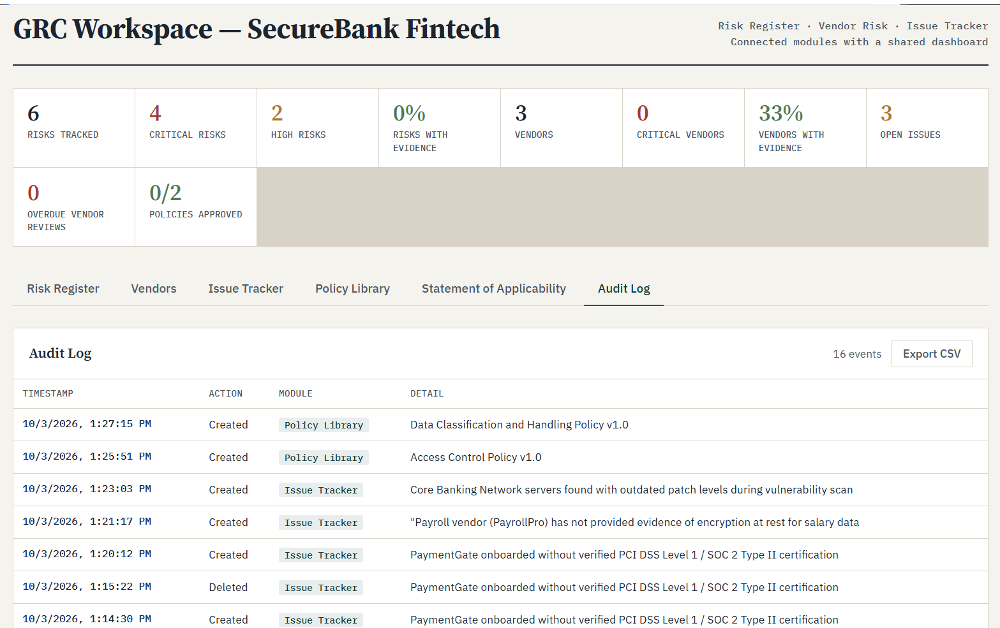
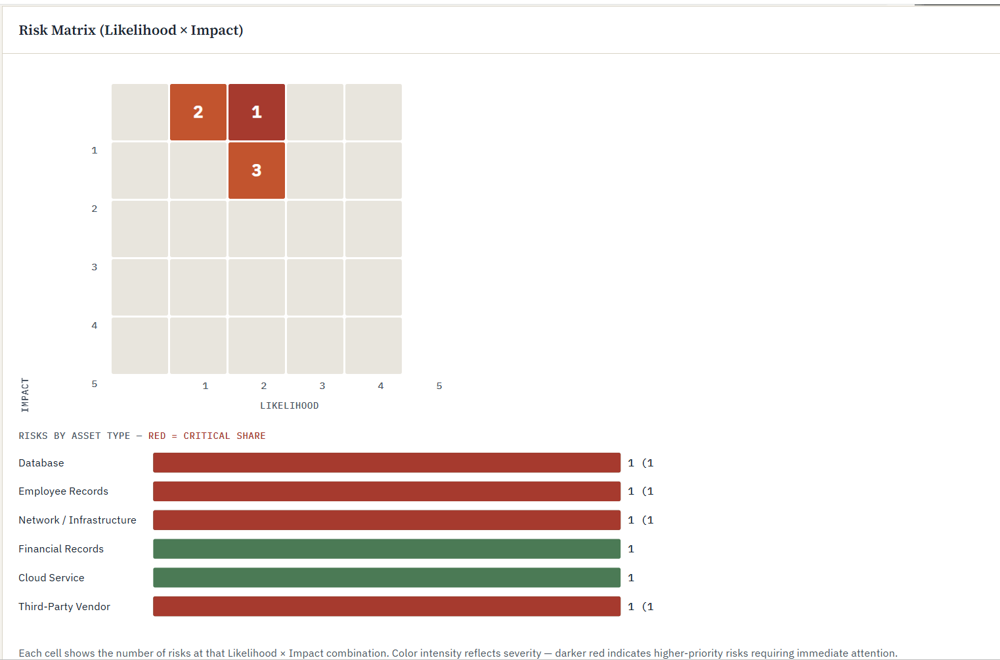
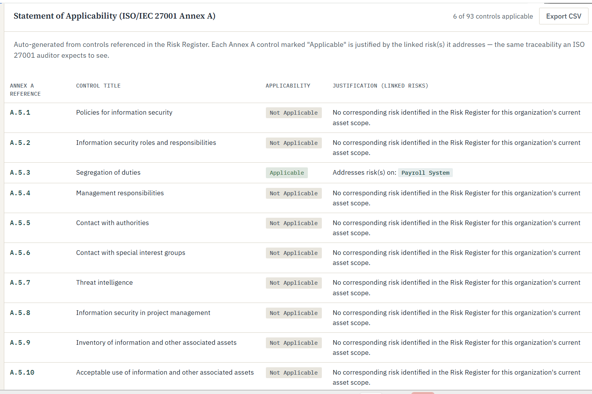
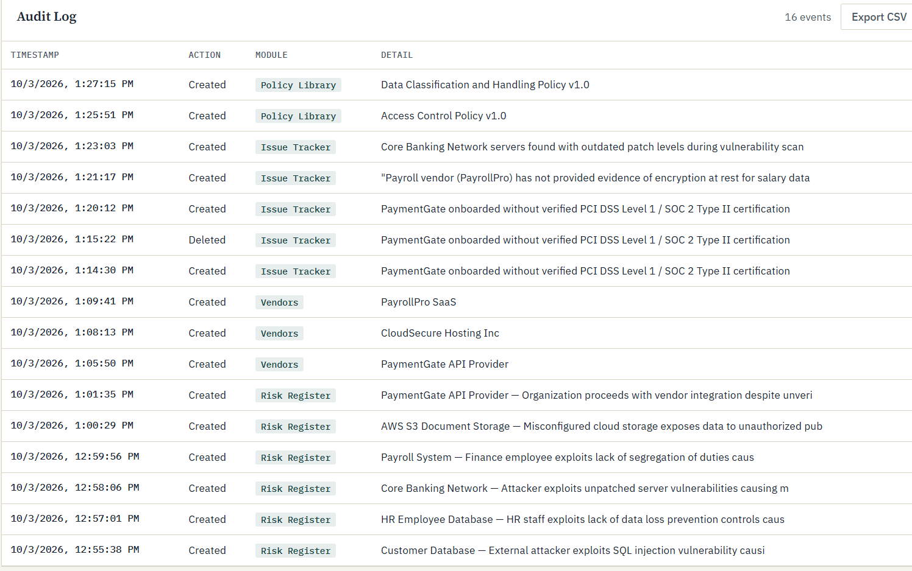

# GRC-workspace — SecureBank Fintech
Try it live: https://leylashahbalayeva.github.io/GRC-workspace/

## What is this?
I built this to understand how real GRC platforms (ServiceNow GRC, Vanta, Archer) actually work under the hood — not just read about risk management, but build something that does it.
It's a web-based GRC tool for a fictional fintech company. You add an asset, it suggests realistic risks for that asset type, picks a matching ISO 27001 control automatically, and tracks everything from the initial risk all the way to whether there's actual evidence the control works — not just a policy sitting on paper.

## What it does?
Risk Register — add an asset (database, employee records, a vendor, whatever), pick a suggested risk or write your own, and the tool auto-fills a matching control with the right ISO/IEC 27001 Annex A reference. There's a 5×5 risk matrix that fills in live as you add risks, plus a chart showing where the critical risks are concentrated.
Vendor Risk Management — score vendors across Security, Compliance, Financial, and Operational dimensions, get an automatic risk rating, and flag vendors whose reviews are overdue.
Issue Tracker — log findings, assign an owner and a due date, and link each issue back to the specific risk it came from.
Policy Library — policies move through Draft → In Review → Approved, same as they would at a real company.
Statement of Applicability — this one auto-generates against all 93 ISO/IEC 27001:2022 Annex A controls. Every control is marked Applicable or Not Applicable, and the "Applicable" ones are justified by whatever risk in the Risk Register triggered them — which is exactly what an ISO auditor checks for.
Audit Log — every single thing you do (create, delete, change a status) gets timestamped and logged.

## Why it's built this way
Everything is connected by ID, not just sitting in separate tables. Link a risk to a vendor, and that vendor's row shows "1 risk(s)" automatically. Add a risk, and the Statement of Applicability updates itself. That connectedness was the whole point — a pile of disconnected spreadsheets isn't really a GRC system, it's just a pile of spreadsheets.

I also made evidence a first-class thing, not an afterthought. A control with no evidence attached shows up with a red ✗ right in the table — because "we wrote a policy about it" and "we can prove it actually works" are very different things, and that distinction is basically the whole job in real GRC.

## Screenshots

**Dashboard**

**Risk Matrix**

**Statement of Applicability**

**Audit Log**

## Built with

Just HTML, CSS, and vanilla JavaScript — no frameworks, no backend, no build step. Data is saved in the browser's localStorage, so it's self-contained and easy to run anywhere.
